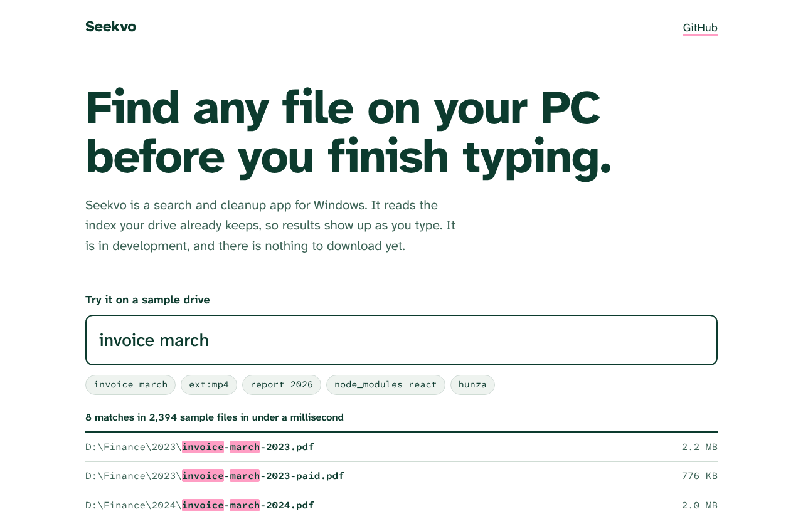
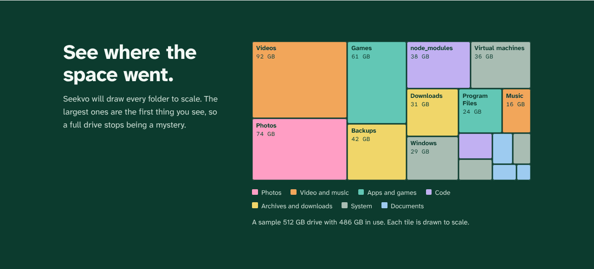

# Seekvo

Seekvo is a search and cleanup app for Windows. It finds any file as you type, shows where your
disk space went, clears out duplicate files, and tidies folders with an AI model that runs on your
own PC.

**Live site: [seekvo.vercel.app](https://seekvo.vercel.app)**

**Status: in development. There is no download yet.** This repository holds the landing page,
with a working search demo over a sample drive, and the first piece of the app: the
[search engine](engine/), written in Rust.



## What Seekvo will do

- **Search.** Read the index an NTFS drive already keeps (the Master File Table and the change
  journal) and list any file by name as you type.
- **Disk map.** Draw every folder to scale so the largest ones are the first thing you see.
- **Duplicates.** Compare files by content, and move extra copies to a holding folder you can
  restore from.
- **Tidy up.** Suggest names and folders with a local AI model. Every change is shown first and can
  be undone.
- **Search by meaning.** Find a file by describing it, and let AI assistants search your files
  through Seekvo, with your permission.

Everything runs on your machine. No account, no uploads, no usage tracking.

## Build order

1. Search
2. Disk map and duplicates
3. Tidy up
4. Search by meaning

Goal for the first release: index a 1 TB drive in under 10 seconds and answer a search in under
50 ms.

## The engine

`engine/` is the file index and search engine, in Rust. From the command line it indexes a whole
NTFS drive by reading the drive's file table directly, or any folder by walking it, and then
searches the result. After the first read it follows the drive's change journal, so new,
renamed and deleted files show up without a rescan, and it can save the index so the next
start does not read the drive at all.

- A real Windows drive with 1.4 million files and folders: first read and index in 9 to 14
  seconds over five runs, with every file's size, 102 MB of memory, and a search answered in
  about 5 ms.
- The same drive, started from a saved index: 0.85 seconds, changes made in the meantime
  included. Timed right after saving; a start after a restart has not been measured.
- Both measured in CI on GitHub's Windows runner, where the tests also change real files and
  check the index follows.
- A made-up drive with 1.1 million entries: every test search answered in under 12 ms on a
  2-core cloud VM.

Details, benchmark and how to run it: [engine/README.md](engine/README.md).

## The landing page

The page is in `src/`. The search field on it runs real code in your browser against about 2,400
made-up file names, and reports how long each search took.

| Part | File |
| --- | --- |
| Search: query parsing, matching, match highlighting | `src/lib/search.ts` |
| Disk map: squarified treemap layout | `src/lib/treemap.ts` |
| Sample drive data | `src/lib/sample-files.ts`, `src/lib/sample-drive.ts` |
| Page and components | `src/app/`, `src/components/` |



### Tech stack

- Next.js 16 (App Router) and React 19
- TypeScript in strict mode
- Hand-written CSS, no UI framework
- Atkinson Hyperlegible Next and Mono, self-hosted
- Vitest for tests, ESLint, GitHub Actions for CI

### Run it locally

You need Node.js 22 or newer.

```bash
git clone https://github.com/Shahryartariq/seekvo.git
cd seekvo
npm install
npm run dev
```

Then open http://localhost:3000.

### Checks

```bash
npm run lint
npm run typecheck
npm test
npm run build
```

## Planned app stack

Rust for the indexing and search engine (started in `engine/`), Tauri for the Windows app, and
local AI models through ONNX Runtime and llama.cpp. This may change as the build goes on.

## Author

Built by [Muhammad Shehryar](https://github.com/Shahryartariq).
